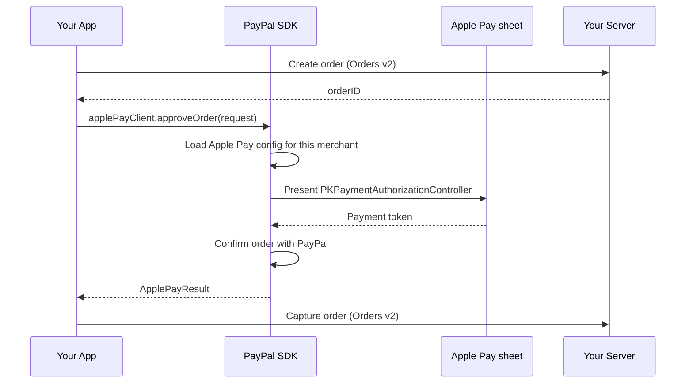

This guide shows how to accept **Apple Pay** in an iOS app with the PayPal Mobile SDK, using the same PayPal Advanced Checkout account you already use on the web.

The SDK presents the system Apple Pay sheet with PassKit. It then confirms the order with PayPal. Buyers do not leave your app, and you do not need a Braintree account.

Your server still creates and captures the order. The SDK only approves it.

## Before you begin

Complete [Install & Setup](../getting-started/install-and-setup.md), then:

* Add the `ApplePay` product (`pod 'PayPal/ApplePay'` or the Swift package product).
* In the Apple Developer portal, create a merchant ID and enable the Apple Pay capability on the app.
* In the PayPal Developer Dashboard, turn on Apple Pay for the same merchant and upload the payment processing certificate created from PayPal's certificate signing request. PayPal uses that certificate to read the payment token.
* Add the merchant ID to the app target under Signing & Capabilities > Apple Pay.

Sandbox and live are selected with `CoreConfig.environment` (`.sandbox` or `.live`). The Apple Pay sheet itself is always the system sheet.

## Flow



Native Apple Pay does not use the web `validateMerchant` step. PassKit validates the merchant with the app entitlement. Confirmation uses the same PayPal `ApproveApplePayPayment` operation as `paypal.Applepay().confirmOrder` on the web.

## Approve an order

```swift
let config = CoreConfig(
    clientID: "<YOUR_CLIENT_ID>",
    environment: .sandbox,
    merchantID: "<YOUR_MERCHANT_ID>"
)
let applePayClient = ApplePayClient(config: config)

let request = ApplePayRequest(
    orderID: orderID,
    merchantIdentifier: "merchant.com.example",
    currencyCode: "USD",
    total: ApplePaySummaryItem(label: "Your Store", amount: 49.99)
)

let result = try await applePayClient.approveOrder(request: request)
```

`result.orderID` is the PayPal order to capture on your server. `result.status` is `APPROVED` when PayPal accepts the token.

Cancellation is `ApplePayError.isCanceled(error)`. Show the buyer your payment methods again. No capture is required.

## Testing in sandbox

* Set `CoreConfig.environment` to `.sandbox` and use a sandbox client ID.
* Use an Apple Pay sandbox tester on a signed-in device or simulator that has a sandbox card in Wallet.
* The unit tests cover the sandbox GraphQL contract (`www.sandbox.paypal.com/graphql?GetApplepayConfig` and `ApproveApplePayPayment`) without charging a card.
* Do not put client secrets, private keys, or live tokens in the app. The client ID is the only PayPal credential the SDK sends.
